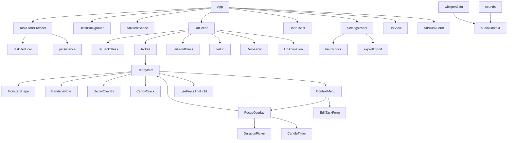
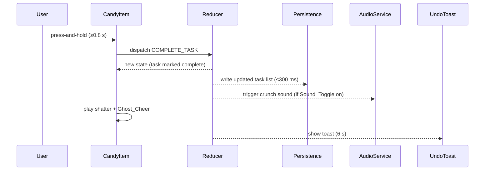

# Design Document

## Overview

Haunted Candy Jar is a React + TypeScript + Vite single-page application that renders a to-do list as a glass jar of candy monsters standing on a candlelit purple desk. Every visual asset is generated in code (CSS, inline SVG, Canvas 2D) with one exception: `public/images/desk-scene.png` (1672x941) is the single allowed bitmap asset and serves as the full-bleed background. Every sound is synthesised via the Web Audio API. The app is fully client-side with no backend: data lives in `localStorage`, and the finished build is a static bundle deployable to Cloudflare Pages.

The design is organised around four concerns:

1. **Core data model and pure logic**, `Task`, `DecayStage`, and the pure `decayFunction` that maps a task + timestamp → stage.
2. **State machine**, a `useReducer`-based store that owns all mutations (create, complete, edit, delete, undo, focus, settings).
3. **Rendering layer**, React components responsible for the jar scene, individual candy shapes, overlays, focus mode, and ambient scene.
4. **Services**, side-effect modules (persistence, audio, export/import) that the reducer dispatches into via effects.

### Key design decisions

| Decision | Choice | Rationale |
|---|---|---|
| State management | `useReducer` + React Context | No external library needed; reducer is a pure function, easy to unit-test; keeps dependency count low for a hackathon |
| Persistence | `localStorage` (JSON) | Simpler API than IndexedDB; ≤40 tasks fit well inside the 5–10 MB limit; synchronous reads keep startup fast |
| Property-based testing library | `fast-check` + `@fast-check/vitest` | Standard pairing for TypeScript + Vitest; first-class arbitrary generators; shrinking built-in |
| Visual rendering | One bitmap background (`desk-scene.png`); inline SVG for the jar and candy monsters; CSS keyframe animations for decay glow and wisps; Canvas 2D for shatter particles | SVG stays crisp at any DPI; CSS GPU-composited animations hit 60 fps without JS; Canvas gives per-frame control for the burst effect; the single photo-style background gives the scene its richness without a large asset pipeline |
| Sound synthesis | Web Audio API, `OscillatorNode`, `GainNode`, `BiquadFilterNode`, `StereoPannerNode` | Zero file payload; API is universally supported on target browsers; sufficient for spooky synth tones |

---

## Art Direction

### Mood

Cozy-creepy candy desk at midnight. The scene holds two opposing light sources in tension: warm amber candlelight (melting candles on the left) and cold blue-white moonlight (the window on the right). The background sits in deep plum and near-black tones. The result is familiar and inviting at first glance, then unsettling on closer inspection, exactly right for a Halloween task manager.

### Color Palette

| Role | Token | Hex |
|---|---|---|
| Background (deep plum) | `color-bg` | `#1A0A2E` |
| Background (near-black) | `color-bg-deep` | `#0D0514` |
| Candlelight warm | `color-candle` | `#FFAA44` |
| Candlelight amber | `color-candle-deep` | `#C85A00` |
| Moonlight cool | `color-moon` | `#B8D4FF` |
| Moonlight accent | `color-moon-deep` | `#6090CC` |
| Glass body tint | `color-glass` | `rgba(190, 220, 255, 0.18)` |
| Glass rim highlight | `color-glass-rim` | `#DCEBFF` |
| Bandage linen | `color-bandage` | `#EFE6D2` |
| Bandage ink | `color-bandage-ink` | `#2B2118` |
| Monster: pumpkin | `monster-pumpkin` | `#FF7A1F` |
| Monster: mummy | `monster-mummy` | `#E8DCC0` |
| Monster: skeleton | `monster-skeleton` | `#F2EEE2` |
| Monster: spider | `monster-spider` | `#5B2A86` |
| Monster: frankenstein | `monster-frankenstein` | `#6FCB4F` |
| Monster: vampire | `monster-vampire` | `#B3203A` |
| Monster: bat | `monster-bat` | `#3C2F63` |
| Monster: gravestone | `monster-gravestone` | `#8E93A3` |

The old `flavor-*` tokens are removed. Monster tokens are the base body color of each monster's radial gradient. Each monster is told apart by its shape (face, bandages, ribs, legs, bolts, fangs, wings, rounded tombstone top) and not by color alone. Decay glow uses a purple that is not a token of its own: it is derived from the `monster-spider` hue at render time.

### Typography

| Role | Font | Delivery |
|---|---|---|
| App title + large section headings only | **Creepster** (Google Fonts, OFL) | Self-hosted: `public/fonts/Creepster-Regular.woff2` |
| Task titles (bandage notes and list rows), body, UI labels, metadata | **Inter** (Google Fonts / Rasmus Andersson, OFL) | Self-hosted: `public/fonts/Inter-VariableFont.woff2` |

Both fonts are bundled at build time via Vite's static asset pipeline (`@font-face` declarations in `src/styles/fonts.css`). No runtime fetch from Google CDN occurs, the app functions fully offline after first load.

Creepster is used **only** for the app title ("Haunted Candy Jar") and large section headings. It is **not** used for task titles anywhere in the UI. Task titles (on bandage notes and in List View) use Inter at a minimum of 12 px. Inter is used for all other UI chrome: buttons, labels, the settings panel, the focus mode countdown, and form fields.

### Lighting Direction

Candlelight originates from the **left** (the melting candles in the desk scene); moonlight originates from the **right** (the window). This direction governs every element in the scene:

- **Specular highlights** on candy surfaces sit near the **top-left** edge (catching both sources but weighted toward the nearer candle).
- **Inner shadows / darkening** accumulate on the **bottom-right** edge.
- The jar glass shows a warm candle glow on its left side and a faint window reflection on its right side.
- Optional code-drawn ghost overlays cast soft warm shadows downward-right.

### Shadow Style

Each interactive element carries **two layered drop shadows**:

1. **Near shadow**, 1–2 px offset, candlelight amber (`rgba(200, 90, 0, 0.35)`), sharp, low spread. Simulates the close candleflame.
2. **Far shadow**, 4–8 px offset, cool blue-gray (`rgba(80, 100, 150, 0.2)`), large blur, represents the distant moonlight fill.

Candy items additionally have a **contact shadow** directly below on the jar floor: a soft dark ellipse (`rgba(0,0,0,0.4)`, blur 6 px), scaled to candy width.

---

## Architecture

The app is structured as a feature-first module layout inside `src/`:

```
src/
├── main.tsx                  # Vite entry, mounts <App />
├── App.tsx                   # Root: wraps providers, renders scene + jar
├── styles/
│   └── fonts.css             # @font-face declarations for Creepster + Inter (self-hosted)
├── features/
│   ├── tasks/
│   │   ├── taskTypes.ts      # Task, DecayStage, MonsterKind (pure types)
│   │   ├── taskReducer.ts    # AppReducer (pure, no side-effects)
│   │   ├── decayFunction.ts  # Pure: (Task, logicalNow) → DecayStage (derived, not stored)
│   │   ├── taskStore.tsx     # Context + provider, wires reducer ↔ persistence
│   │   └── sampleData.ts     # Six sample candies for demo mode
│   ├── candy/
│   │   ├── MonsterShape.tsx  # Dispatches to one of 8 SVG candy monsters by task.monster
│   │   ├── monsters/         # PumpkinMonster, MummyMonster, SkeletonMonster, SpiderMonster, FrankensteinMonster, VampireMonster, BatMonster, GravestoneMonster
│   │   ├── BandageNote.tsx   # Mummy-bandage note (linen strip, frayed edges, tilt, tail toward candy)
│   │   ├── DecayOverlay.tsx  # Per-stage look: dull, faint purple glow, strong glow + wisps, grey + cracks + glow
│   │   ├── CandyCrack.tsx    # Animated crack SVG (press-and-hold progress)
│   │   ├── GhostCheer.tsx    # Ghost sprite post-completion
│   │   └── CandyItem.tsx     # Composed candy + tag + overlays + gesture handling
│   ├── jar/
│   │   ├── JarScene.tsx      # Composes JarBackGlass, candies (clipped), JarFrontGlass, JarLid, DeskGlow
│   │   ├── JarBackGlass.tsx  # Back glass layer
│   │   ├── JarFrontGlass.tsx # Front glass layer (rim, streaks, reflection, thick base)
│   │   ├── JarLid.tsx        # Lid with round knob
│   │   ├── DeskGlow.tsx      # Soft shadow and warm glow on the desk under the jar
│   │   ├── LidAnimation.tsx  # Lid lift, tilt, settle; coordinates candy drop in / float out
│   │   ├── JarPile.tsx       # Precomputed packing layout, drop-in animation, desk spill for extras
│   │   ├── ListView.tsx      # Accessible <ul> list view (keyboard / screen reader primary)
│   │   └── EmptyState.tsx    # Prompt shown when task list is empty
│   ├── contextMenu/
│   │   └── ContextMenu.tsx   # Complete / Focus / Edit / Delete (popover desktop, bottom sheet mobile)
│   ├── forms/
│   │   ├── MonsterPicker.tsx # Grid of 8 small monster buttons, each with an accessible name
│   │   ├── AddTaskForm.tsx   # Title, due date, monster picker (modal / bottom sheet)
│   │   └── EditTaskForm.tsx  # Same fields pre-populated, opened from context menu Edit action; picker writes to task.monster
│   ├── focus/
│   │   ├── FocusOverlay.tsx  # Darkened full-screen overlay
│   │   ├── DurationPicker.tsx# 1–90 min input with 15/25/50 presets
│   │   └── CandleTimer.tsx   # Animated burning candle / numerical fallback
│   ├── scene/
│   │   ├── DeskBackground.tsx # Full-bleed desk-scene.png, top gradient, mobile object-position 82%
│   │   ├── AmbientScene.tsx  # Optional code-drawn fog and ghost overlays on top of the background
│   │   └── CandleGlow.tsx    # Pulsing radial gradient over the left candles
│   ├── settings/
│   │   ├── SettingsPanel.tsx # Sound toggle, haunt speed, export, import (bottom sheet on mobile)
│   │   └── hauntClock.ts     # Logical clock with Haunt_Speed multiplier
│   ├── undo/
│   │   └── UndoToast.tsx     # 6-second dismissible toast
│   └── audio/
│       ├── audioContext.ts   # Singleton AudioContext factory
│       ├── sounds.ts         # Synthesised sound functions (includes lid creak and glass clink)
│       └── whisperGain.ts    # Gain budget manager for Cursed-candy whispers
├── hooks/
│   ├── usePressAndHold.ts    # Pointer + keyboard hold gesture with progress callback
│   ├── useHauntClock.ts      # Returns current logical timestamp (respects Haunt_Speed)
│   └── useReducedMotion.ts   # Reads prefers-reduced-motion media query
└── utils/
    ├── persistence.ts        # localStorage read / write / error handling
    ├── exportImport.ts       # serializeTaskList / deserializeTaskList
    ├── taskSchema.ts         # Zod schema for Task, used by import validation
    ├── idGen.ts              # crypto.randomUUID wrapper
    ├── monsterKind.ts        # MONSTER_KINDS list and taskIdToMonster(id): deterministic default monster
    ├── (optional) icsParser.ts # Pure .ics parser for the calendar import feature
    └── packingLayout.ts      # Seeded packing layout computation (task IDs as seed)
```

### Component dependency graph



### Data flow



---

## Components and Interfaces

### Task store (Context + Reducer)

The store is the single source of truth for all mutable app state. It is provided at the root via `<TaskStoreProvider>` and consumed through `useTaskStore()`.

```typescript
// AppState shape
interface AppState {
  tasks: Task[];
  selectedTaskId: string | null;
  pendingUndo: { task: Task; action: 'complete' | 'delete' } | null;
  focusSession: FocusSession | null;
  soundEnabled: boolean;
  hauntSpeed: 1 | 60 | 3600;
}

// Dispatcher action union
type AppAction =
  | { type: 'CREATE_TASK'; payload: CreateTaskInput }
  | { type: 'COMPLETE_TASK'; taskId: string }
  | { type: 'DELETE_TASK'; taskId: string }
  | { type: 'EDIT_TASK'; taskId: string; payload: EditTaskInput }
  | { type: 'SELECT_TASK'; taskId: string | null }
  | { type: 'UNDO' }
  | { type: 'UNDO_EXPIRED' }
  | { type: 'START_FOCUS'; taskId: string; durationMinutes: number }
  | { type: 'END_FOCUS'; markComplete: boolean }
  | { type: 'SET_SOUND'; enabled: boolean }
  | { type: 'SET_HAUNT_SPEED'; speed: 1 | 60 | 3600 }
  | { type: 'IMPORT_TASKS'; tasks: Task[] }
  | { type: 'CLEAR_SAMPLES' };
```

### CandyItem

The core interactive component. Owns the press-and-hold gesture, renders the composed candy, and delegates to the context menu. Tapping a candy lifts it out of the jar (translate up and slightly forward), reveals its `BandageNote`, and opens the `ContextMenu` beside it; dismissing the menu returns the candy to its slot. Press and hold for 0.8 s (or Space) cracks it; releasing early heals the cracks. Under reduced motion the lift is an instant state change.

```typescript
interface CandyItemProps {
  task: Task;
  slot: number;          // position index in the packing layout
  isSelected: boolean;
  rotation: number;      // ±15° stable rotation derived from task ID
  onGestureComplete: () => void;   // fires when hold threshold reached
}
```

Internal state: `crackProgress` (0–1 float, drives the SVG crack overlay opacity/path depth).

Each `CandyItem` renders a stacked composition: `MonsterShape` (base SVG monster body) → `DecayOverlay` (stage-specific look) → `CandyCrack` (hold-progress overlay) → `BandageNote` (linen note with truncated title, shown when the candy is lifted or hovered/focused). The candy's tappable hit area is always at least 44×44 px regardless of visual size or rotation, enforced via a transparent hit-area `<rect>` in the SVG.

### MonsterShape

Renders one of eight SVG candy monsters. The kind comes from `task.monster` (a `MonsterKind`). `monsterKind.ts` also exports `taskIdToMonster(id)`, a deterministic hash of the id that is used to auto-assign a monster when the user does not choose one at creation time.

```typescript
type MonsterKind =
  | 'pumpkin' | 'mummy' | 'skeleton' | 'spider'
  | 'frankenstein' | 'vampire' | 'bat' | 'gravestone';

interface MonsterShapeProps {
  kind: MonsterKind;
  decayStage: DecayStage;   // passed to DecayOverlay and to the shine controls
  size?: number;             // px, default 72 desktop / 60 mobile
}
```

#### Monster designs (all original)

| Kind | Silhouette and face |
|---|---|
| pumpkin | Round ribbed body, small stem, triangle eyes, jagged grin |
| mummy | Rounded body wrapped in crossing bandage bands, two eyes peeking through a gap |
| skeleton | Rounded skull body, big eye sockets, small nose gap, row of teeth |
| spider | Round body with four short legs on each side, cluster of small eyes |
| frankenstein | Flat-topped square-ish body, neck bolts on the sides, stitched brow and mouth |
| vampire | Round body with a widow's-peak hairline, small fangs, tiny cape collar |
| bat | Round body with two pointed wing shapes and small ears, tiny fangs |
| gravestone | Arched tombstone body with a small cross and friendly eyes |

All monsters share the hard-candy look:
- Radial gradient body using the `monster-*` color token (lighter center, darker edge)
- A bright specular highlight near the top-left (white, `opacity: 0.85`)
- A small sparkle (four-point star) near the highlight
- Soft inner shadow on the bottom-right edge (`rgba(0,0,0,0.25)`)
- Contact shadow below (soft ellipse, `rgba(0,0,0,0.4)`, blur 6 px)
- Default size: `72px` desktop, `60px` mobile
- No raster images; SVG paths and gradients only

### BandageNote

A "mummy bandage" note attached to each candy. It is an off-white linen strip (`color-bandage`) with a faint woven texture (SVG pattern), torn frayed edges (jagged SVG path ends), a slight tilt (2 to 4 degrees, stable per task ID), and a short bandage tail hanging toward its candy. It displays the task title truncated to about 18 characters with an ellipsis.

```typescript
interface BandageNoteProps {
  title: string;
  tiltSeed: string;     // task id, used for the stable tilt
  selected: boolean;    // when true, the full title is shown in the context menu, not the note itself
}
```

Font: Inter, minimum 12 px, ink color `color-bandage-ink` (dark). The `ListView` rows reuse the same bandage style (linen background, frayed ends, dark ink) through a shared CSS class so the two stay consistent.

### DecayOverlay

Conditionally renders the stage-specific look on a candy. The five stages are `Fresh`, `Dull`, `Spooky`, `Haunted` and `Cursed`.

| Stage | Stage number | Look |
|---|---|---|
| Fresh | 1 | Glossy, full highlight and sparkle, no glow |
| Dull | 2 | Duller body, reduced highlight opacity, no glow |
| Spooky | 3 | Faint purple glow halo (soft `drop-shadow` plus a radial gradient behind the candy) |
| Haunted | 4 | Strong purple glow plus ghostly wisps (two or three translucent wavy SVG wisp paths rising from the candy, slow drift) |
| Cursed | 5 | Mostly grey and darker body (`saturate` low, `brightness` down), dark crack lines across the body, and a purple glow |

Cursed cracks are a warning only: the task is still finished by press and hold, and the crack lines are drawn in a separate style from the hold-progress cracks of `CandyCrack`.

Non-color distinguishing attributes (Requirement 7.12 and 12.6): the glow halo (stages 3 to 5), the wisp shapes (stage 4), and the crack lines (stage 5) are the shape and texture differences between adjacent stages. Stage 1 versus 2 differs by highlight and sparkle presence. Under `prefers-reduced-motion`, glow pulses and wisp drift are frozen into static shapes.

### JarPile and JarScene

**JarScene** renders the glass jar as a tall SVG that stands on the empty middle of the desk in `desk-scene.png`. It is drawn in three layers, back to front:

1. **Back glass** (`JarBackGlass`): the inner back wall, a faint tint (`color-glass`), and darker inner edges.
2. **Candies** (`JarPile`): rendered inside an SVG `clipPath` that matches the jar's inside shape, so no candy pokes through the glass.
3. **Front glass** (`JarFrontGlass`): a brighter rim on the sides (`color-glass-rim`), slightly darker edges, vertical light streaks, a faint window reflection on the right, and a thick glass base.

On top sit the **lid with a round knob** (`JarLid`) and a warm candle glow on the left side of the glass. Under the jar, `DeskGlow` draws a soft shadow and a warm glow on the desk. A slight refraction tint on candies near the glass edges (5% desaturation plus a cool tint via CSS filter) applies only to candies whose packing position is within about 12 px of the jar wall.

**JarPile** replaces the former `JarGrid`. Candies settle at the bottom of the jar in a precomputed packing layout:
- Layout is computed once per task-set change by `packingLayout.ts`, using a seeded random number generator initialised with a hash of the full set of task IDs. The result is stable, the same set of tasks always produces the same positions.
- Slight overlap between adjacent candies is permitted (max 10% of candy radius).
- Each candy has a stable random rotation between ±15°, also seeded per task ID.
- When a new candy is added, `LidAnimation` lifts and tilts the lid, the candy **drops in from the lid** and animates to its computed position using a CSS spring transition (or `spring()` from a small physics helper), then the lid settles back. Under `prefers-reduced-motion`, the lid does not move and the candy fades in (150 ms max).
- Every candy maintains a minimum 44×44 px tappable hit area regardless of visual size or rotation, enforced via a transparent SVG `<rect>` hit target.

**Overflow (>40 candies):** the jar holds 40 candies. When the task list exceeds 40 incomplete items, the extra candies spill onto the desk next to the jar (positions from `packingLayout.ts`, drawn outside the clip path, in front of the desk). There is no scrolling and no "+N more" badge. All candies, inside the jar or on the desk, remain individually selectable.

### LidAnimation

`src/features/jar/LidAnimation.tsx` owns the lid sequence and exposes it to `JarScene` and `JarPile`.

- **Add:** lid lifts and tilts (CSS transform, about 350 ms), candy drops in with the existing spring bounce, lid settles back.
- **Remove:** lid lifts and tilts, the candy floats out (completion and delete), lid settles back.
- **Sounds (Web Audio only, off by default):** `playLidCreak()` plays when the lid opens: a short creaky door creak of about 0.5 s (sawtooth oscillator through a band-pass filter with a slow pitch wobble), with a slightly different base pitch each call (small random detune). `playGlassClink()` plays when the lid closes: a soft, short, high sine pair with a fast decay. Both check `soundEnabled` and return immediately when disabled.
- **Reduced motion:** the lid does not move; candies fade in or out (150 ms max). The sounds still follow the Sound Toggle.
- Multiple adds in a row (for example the optional calendar import) queue so the lid opens once per candy, one by one.

### DeskBackground

`src/features/scene/DeskBackground.tsx` renders `public/images/desk-scene.png` (1672x941) full-bleed with `object-fit: cover`. On mobile viewports it uses `object-position: 82% center` so the moonlit window shows behind the jar. A soft dark gradient at the top keeps the title readable. `desk-scene.png` is the single allowed bitmap asset.

### ListView

An accessible `<ul>` list that shows all tasks sorted by decay stage (Cursed first). Rows use the same bandage style as `BandageNote` (linen strip, frayed ends, dark ink). Each `<li>` shows: task title (Inter, minimum 12 px), due date if set, decay stage label as a `<span>` with an ARIA label, and a row of action buttons (Complete, Focus, Edit, Delete) that map to the same reducer actions as the context menu.

A **"List View" toggle button** sits in the top bar (desktop) or top bar (mobile), keyboard-reachable via Tab. Activating it swaps the main content region from `JarScene` to `ListView` and back. The jar view is the default. The toggle carries `aria-pressed` state.

### AddTaskForm

Opens in a **modal** on desktop and a **bottom sheet** on mobile, triggered by the "Add candy" FAB or bar.

Fields:
- **Title** (`<input type="text">`, required, inline validation on submit)
- **Due date** (`<input type="date">`, optional)
- **Monster picker** (`MonsterPicker`): a grid of 8 small monster buttons (pumpkin, mummy, skeleton, spider, frankenstein, vampire, bat, gravestone). Each button shows a small monster thumbnail, has an accessible name equal to the monster name (`aria-label`), carries `aria-pressed`, is at least 44x44 px, and is keyboard navigable with arrow keys; selection is indicated by a ring outline plus a check mark (not color alone). If the user does not choose, the form leaves the choice empty and `createTask` assigns one by `taskIdToMonster(id)`. The stored `task.monster` is always one of the 8 kinds.

All fields are fully keyboard navigable. The form closes on Escape or Cancel without creating a task.

### CandyCrack

Renders hairline SVG crack paths over the candy during a press-and-hold. Progress (0–1) maps to opacity and path stroke-width. On early release, the component animates `progress` back to 0 using a CSS transition.

### CandleTimer

```typescript
interface CandleTimerProps {
  totalSeconds: number;
  remainingSeconds: number;
  reducedMotion: boolean;   // when true, renders numeric countdown instead
}
```

The animated variant draws a tall, thin SVG rectangle (the candle body) whose height shrinks from 100% to 0% over the session. A flame SVG sits on top with a wobble animation. The numerical fallback is a plain `<time>` element inside an ARIA live region.

### ContextMenu

Keyboard-accessible overlay with four buttons: Complete, Focus, Edit, Delete. It appears when a candy is tapped: the candy lifts out of the jar, its `BandageNote` is shown, and the menu sits beside them. Dismissing returns the candy to the jar. On **desktop**, it is positioned adjacent to the lifted candy using CSS absolute positioning within a relative-positioned jar slot. On **mobile**, it renders as a **bottom sheet** that slides up from the bottom edge of the viewport. Closes on `Escape` or outside click via a `useClickOutside` hook.

### UndoToast

Displays a notification at the bottom of the screen. Owns a 6-second `setTimeout`; dispatches `UNDO_EXPIRED` on natural expiry. If a second action fires while visible, the first dispatch fires immediately and the toast re-mounts for the second action.

### AmbientScene (optional extras)

The main scene is the `DeskBackground` image. `AmbientScene` is now an optional, code-drawn SVG overlay on top of it. Layers from back to front:

1. Candlelight glow over the left candles (pulsing `<radialGradient>` via CSS animation; `CandleGlow`)
2. Fog ribbons (SVG `<path>` with slow horizontal `translate` keyframe; static under `prefers-reduced-motion`)
3. Ghost figures (SVG `<g>` with gentle float animation; static under `prefers-reduced-motion`)

Fog and ghosts may be skipped without affecting any requirement.

---

## Mobile Layout

The app adapts its chrome and navigation patterns for mobile viewports (< 768 px wide). The core jar experience is preserved; only layout and control surfaces change.

| Element | Desktop | Mobile |
|---|---|---|
| Desk background | Full-bleed, `object-position` centered | Full-bleed, `object-position: 82% center` so the window shows behind the jar |
| Jar | Centered, fixed width (~480 px) | Centered, `~90vw`, fills most of viewport |
| "Add candy" action | Button in top bar or sidebar | **FAB (floating action button)** fixed at bottom-right, or a full-width bar above the system nav |
| Settings panel | Modal or sidebar | **Bottom sheet**, slides up from the bottom edge, dismissible with swipe-down or a close button |
| Context menu | Floating popover adjacent to candy | **Bottom sheet**, slides up from the bottom, same four actions in a larger touch-friendly list |
| List View toggle | Button in top bar | Button in top bar (same position, smaller label or icon-only with `aria-label`) |
| Undo toast | Bottom-center | Bottom-center, above the FAB |

### Bottom sheet behavior

Both the settings panel and the context menu use the same `BottomSheet` component: a fixed panel that covers the bottom portion of the viewport, with a drag handle at the top. It traps keyboard focus while open, dismisses on Escape or a tap on the scrim, and respects `prefers-reduced-motion` (instant appear/dismiss instead of slide animation).

### Touch targets

All interactive elements on mobile have a minimum hit area of 44×44 CSS pixels. Candy hit areas are enforced via a transparent SVG `<rect>` overlay as described in the JarPile section. FAB is at least 56×56 px per Material/HIG conventions.

---

## Data Models

### Task

```typescript
type DecayStage = 'Fresh' | 'Dull' | 'Spooky' | 'Haunted' | 'Cursed';

type MonsterKind =
  | 'pumpkin'
  | 'mummy'
  | 'skeleton'
  | 'spider'
  | 'frankenstein'
  | 'vampire'
  | 'bat'
  | 'gravestone';

interface Task {
  id: string;               // crypto.randomUUID()
  title: string;            // non-empty after trim
  dueDate: number | null;   // Unix timestamp ms (real wall-clock), or null
  monster: MonsterKind;     // user-chosen or auto-assigned via taskIdToMonster(id) at creation; always set
  isSample: boolean;        // true for seeded demo candies
  createdAt: number;        // real wall-clock timestamp at creation (Date.now(), ms)
  completedAt: number | null; // real wall-clock timestamp on completion, or null
}

type PersistedTaskList = Task[];  // serialised as JSON array in localStorage key 'hcj_tasks'
```

`DecayStage` is **not stored** on the `Task` record. It is a **derived value**, computed fresh on each render (and each haunt-clock tick) by calling `decayFunction(task, logicalNow)`. Storing it would risk stale cached stages after a Haunt_Speed change and would cause the round-trip serialisation property to diverge.

`createdAt`, `dueDate`, and `completedAt` are **always real wall-clock timestamps** (`Date.now()` in ms). They are never overwritten with logical time. Haunt_Speed only affects the `logicalNow` argument passed to `decayFunction`, it never mutates persisted data.

### FocusSession

```typescript
interface FocusSession {
  taskId: string;
  durationSeconds: number;
  startedAt: number;        // wall-clock Date.now()
}
```

### CreateTaskInput / EditTaskInput

```typescript
interface CreateTaskInput {
  title: string;
  dueDate: number | null;
  monster: MonsterKind | null;  // null → auto-assign via taskIdToMonster(id)
}

interface EditTaskInput {
  title: string;
  dueDate: number | null;
  monster: MonsterKind;
}
```

### Serialisation format

Tasks are stored and exported as a JSON array of `Task` objects. Because `DecayStage` is a derived value (not stored), it is absent from the serialised format; it is recomputed from stored timestamps on load. The `monster` field is included in the serialised format and is always one of the eight kinds. The import path validates the array against a Zod schema before accepting it; schema mismatch triggers an error message with no state change.

The Zod schema for a `Task` record includes `monster` as an enum of `MonsterKind`:

```typescript
const MonsterKindSchema = z.enum([
  'pumpkin', 'mummy', 'skeleton', 'spider',
  'frankenstein', 'vampire', 'bat', 'gravestone',
]);

const TaskSchema = z.object({
  id: z.string().min(1),
  title: z.string().min(1),
  dueDate: z.number().nullable(),
  monster: MonsterKindSchema,
  isSample: z.boolean(),
  createdAt: z.number(),
  completedAt: z.number().nullable(),
});
```

---

## Correctness Properties

*A property is a characteristic or behavior that should hold true across all valid executions of a system, essentially, a formal statement about what the system should do. Properties serve as the bridge between human-readable specifications and machine-verifiable correctness guarantees.*

### Property 1: Task creation populates all required fields

*For any* non-empty (non-whitespace) title string and optional due-date value, calling `createTask()` shall return a Task record whose `id` is non-empty, `title` equals the trimmed input, `completedAt` is `null`, and `createdAt` is the logical timestamp passed to the function. Because `DecayStage` is derived rather than stored, the initial stage, `'Fresh'`, is verified by calling `decayFunction` on the newly created task with `logicalNow = createdAt`, which must return `'Fresh'`.

**Validates: Requirements 1.1**

---

### Property 2: Empty-title rejection

*For any* string composed entirely of whitespace characters (including the empty string), the task-creation logic shall reject the input and return no Task record.

**Validates: Requirements 1.4**

---

### Property 3: Task serialisation round-trip

*For any* valid `Task` object (which does not include `decayStage`, as that field is derived and not persisted), serialising it to JSON via `serializeTaskList` and then deserialising via `deserializeTaskList` shall produce a `Task` object that deep-equals the original, including the `monster` field (one of the eight `MonsterKind` values).

**Validates: Requirements 2.5, 16.4**

---

### Property 4: Decay function: due-date path correctness

*For any* incomplete Task that has a `dueDate` and *for any* current logical timestamp, `decayFunction(task, now)` shall return the stage defined by the threshold rules in Requirement 7.2: `Fresh` when due date is more than 48 h away; `Dull` within 48 h; `Spooky` within 24 h; `Haunted` within 2 h or up to 24 h past due; `Cursed` more than 24 h past due.

**Validates: Requirements 7.2**

---

### Property 5: Decay function: age-based path correctness

*For any* incomplete Task with no `dueDate` and *for any* current logical timestamp, `decayFunction(task, now)` shall return the stage defined by the age thresholds in Requirement 7.3: `Fresh` < 3 days; `Dull` ≥ 3 d < 7 d; `Spooky` ≥ 7 d < 14 d; `Haunted` ≥ 14 d < 21 d; `Cursed` ≥ 21 d.

**Validates: Requirements 7.3**

---

### Property 6: Decay function monotonicity

*For any* incomplete Task (with or without a due date) and *for any* pair of logical timestamps T1 ≤ T2, the numeric ordinal of `decayFunction(task, T2)` shall be greater than or equal to the ordinal of `decayFunction(task, T1)`. Decay stages never reverse as time advances.

**Validates: Requirements 8.2**

---

### Property 7: Undo restores prior task state

*For any* task list and *for any* task in that list, applying a `COMPLETE_TASK` or `DELETE_TASK` action followed immediately by `UNDO` shall produce a task list that deep-equals the list before the action, including the task's `monster`, `dueDate`, and `createdAt`. Because `decayStage` is derived and not stored, the restored task will naturally produce the same `DecayStage` as before when `decayFunction` is called with the same `logicalNow`. Storing wall-clock timestamps (`createdAt`, `dueDate`, `completedAt`) and passing `logicalNow` as a parameter to `decayFunction` ensures that Haunt_Speed never mutates persisted data and that undo always restores a faithful record.

**Validates: Requirements 5.2**

---

### Property 8: Whisper gain budget is bounded

*For any* integer N (1 ≤ N ≤ 24) representing the number of currently visible Cursed candies with active whisper nodes, the sum of gain values assigned across all N nodes shall not exceed the default single-whisper gain level, and each node shall receive exactly `defaultGain / N`.

**Validates: Requirements 11.1, 11.2**

---

## Optional Features

### Wallpaper mode (optional, Requirement 20)

`App.tsx` reads `new URLSearchParams(location.search).get('view')`. When it equals `wallpaper`, the app renders only `DeskBackground`, `JarScene` and the candies full screen. The add button, settings, list toggle, toasts and context menu are not mounted, candies ignore pointer and keyboard input (read only), and the haunt clock keeps ticking so decay stages update live. It is meant for free live-wallpaper apps such as Plash (Mac) or Lively Wallpaper (Windows). No new network calls are made.

### Calendar file import (optional, Requirement 21)

A pure `src/utils/icsParser.ts` turns the text of a `.ics` file into a list of `{ title, start }` events (handling `SUMMARY` and `DTSTART` in date and date-time forms, line unfolding, and UTC `Z` suffix). The settings panel reads the file with `FileReader` (no network, no sign-in), keeps events whose start is in the future, and dispatches `CREATE_TASK` per event with `dueDate = start`. The candies drop in one by one through the `LidAnimation` queue. A parse failure shows an inline error and leaves the task list unchanged.

### Credits (Requirement 22)

The README has a Credits section: the desk background art was made by Milena Webb with ChatGPT; an early visual mockup was sketched with Claude as a reference only; all app code was built in Kiro.

---

## Error Handling

| Failure scenario | Detection point | Recovery |
|---|---|---|
| `localStorage` unavailable or quota exceeded on write | `persistence.ts` try/catch | Log warning to console; show non-blocking banner; in-memory state continues normally |
| `localStorage` read error on startup | `persistence.ts` try/catch | Show non-blocking warning banner; start with empty task list (Req 2.3) |
| Imported JSON fails `JSON.parse` | `exportImport.ts` | Show inline error message; leave current task list unchanged (Req 16.3) |
| Imported JSON fails Zod schema validation | `taskSchema.ts` | Show inline error with schema mismatch detail; leave current task list unchanged (Req 16.3) |
| `AudioContext` blocked by browser autoplay policy | `audioContext.ts` try/catch | Catch `NotAllowedError`; silently disable audio until user interaction resumes the context |
| `crypto.randomUUID` unavailable (very old Safari) | `idGen.ts` | Fallback to `Math.random()`-based UUID v4 |
| Focus session task deleted while session active | `taskReducer.ts` `DELETE_TASK` case | End focus session automatically; show notification "Focused task was deleted" |
| Undo invoked after toast timeout race condition | `taskReducer.ts` `UNDO` case | Guard: if `pendingUndo` is null, dispatch is a no-op |

---

## Testing Strategy

### Dual approach

The project uses **Vitest** as the test runner throughout.

- **Unit / example-based tests** cover specific scenarios, edge cases, and integration between components.
- **Property-based tests** use `fast-check` + `@fast-check/vitest` to verify universal invariants across a generated input space. Each property test runs a minimum of **100 iterations** per execution.

### Unit tests

Target: `src/features/tasks/taskReducer.ts`, `src/features/tasks/decayFunction.ts`, component behaviour.

Key examples and edge cases:

- `CREATE_TASK` with valid input produces the correct Task shape.
- `CREATE_TASK` with whitespace-only title does not add to the task list.
- `COMPLETE_TASK` → `UNDO` restores the original task list.
- `DELETE_TASK` → `UNDO` restores the original task list.
- `UNDO_EXPIRED` while no pending undo is a no-op.
- Second action while toast active: first action is committed, new toast shown.
- `decayFunction` returns `'Fresh'` for a task due 72 h from now.
- `decayFunction` returns `'Cursed'` for a task due 48 h ago.
- Persistence write is called within 300 ms of a state change.
- Import of malformed JSON shows error and does not mutate task list.
- `whisperGain.allocate(3)` returns `defaultGain / 3` per node.

### Property-based tests

Each test is tagged with a comment identifying its design property.

```typescript
// Feature: haunted-candy-jar, Property 1: Task creation populates all required fields
it.prop([fc.string({ minLength: 1 }).filter(s => s.trim().length > 0), fc.option(fc.integer())])
  ('createTask fills all required fields', (title, dueDate) => { ... });

// Feature: haunted-candy-jar, Property 2: Empty-title rejection
it.prop([fc.string().filter(s => s.trim().length === 0)])
  ('createTask rejects whitespace-only titles', (title) => { ... });

// Feature: haunted-candy-jar, Property 3: Task serialisation round-trip
it.prop([fc.array(arbitraryTask())])
  ('serialize then deserialize is identity', (tasks) => { ... });

// Feature: haunted-candy-jar, Property 4: Decay function due-date path correctness
it.prop([arbitraryDueDateTask(), fc.integer()])
  ('decayFunction due-date path matches thresholds', (task, now) => { ... });

// Feature: haunted-candy-jar, Property 5: Decay function age-based path correctness
it.prop([arbitraryNoDueDateTask(), fc.integer()])
  ('decayFunction age-based path matches thresholds', (task, now) => { ... });

// Feature: haunted-candy-jar, Property 6: Decay function monotonicity
it.prop([arbitraryIncompleteTask(), fc.integer(), fc.integer()])
  ('decayFunction never decreases as time advances', (task, t1raw, t2raw) => {
    const [t1, t2] = [Math.min(t1raw, t2raw), Math.max(t1raw, t2raw)];
    expect(stageOrdinal(decayFunction(task, t2)))
      .toBeGreaterThanOrEqual(stageOrdinal(decayFunction(task, t1)));
  });

// Feature: haunted-candy-jar, Property 7: Undo restores prior task state
it.prop([fc.array(arbitraryTask(), { minLength: 1 }), fc.constantFrom('complete', 'delete')])
  ('undo after action restores original list', (tasks, action) => { ... });

// Feature: haunted-candy-jar, Property 8: Whisper gain budget is bounded
it.prop([fc.integer({ min: 1, max: 24 })])
  ('whisper gain never exceeds single-whisper budget', (n) => {
    const nodes = allocateWhisperGain(n, DEFAULT_WHISPER_GAIN);
    const total = nodes.reduce((sum, g) => sum + g, 0);
    expect(total).toBeLessThanOrEqual(DEFAULT_WHISPER_GAIN + Number.EPSILON);
    nodes.forEach(g => expect(g).toBeCloseTo(DEFAULT_WHISPER_GAIN / n));
  });
```

### Integration / component tests

Use **React Testing Library** (RTL) for DOM-level interaction tests:

- Clicking a candy selects it and shows the Context_Menu.
- Press-and-hold simulation (via pointer events at 800+ ms) triggers `COMPLETE_TASK`.
- Press-and-hold release before 800 ms does not trigger completion.
- Focus mode: selecting "Focus" opens duration picker with presets 15, 25, 50 and default 25.
- Empty-state prompt renders when task list is empty.
- Haunt_Speed control renders with values 1×, 60×, 3600× in settings panel.
- ARIA labels update when a candy's decay stage changes.
- Context_Menu closes on Escape keypress without changing task.
- Undo toast renders after a task deletion; clicking undo re-adds the task.

### Accessibility tests

Use **axe-core** via `@axe-core/react` in development, and `vitest-axe` in CI:

- No accessibility violations on initial render.
- No violations when context menu is open.
- No violations during focus mode.
- Candle timer ARIA live region is present and labelled.
