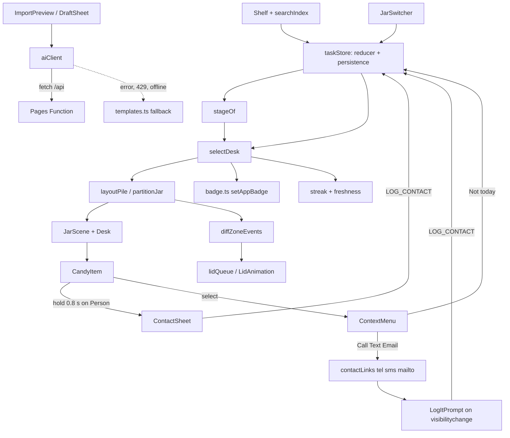
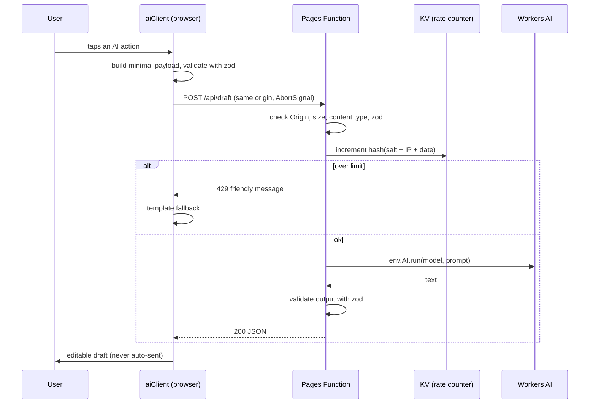

# Design Document: Haunted Contacts

## Overview

Haunted Contacts evolves Haunted Candy Jar from a to-do jar into a to-do and relationship jar ("contacts that never go stale"). A Candy is now either a Task or a Person. Persons decay by time since the last contact, compared with a Rhythm. Due and Cursed Persons escape to the desk, where the user can call, text, email, snooze, or mark them Reached out. Candies live in several jars, can be found on a Shelf, and optional AI helpers (import, drafts) run through one Cloudflare endpoint. Data stays in the browser. This document builds on `.kiro/specs/haunted-candy-jar/design.md` (the base design) and covers Requirements 1 to 14 of `requirements.md`.

### What stays and what is new

| Area | Stays as is (base spec) | New or changed |
|---|---|---|
| Jar rendering | JarScene, glass layers, JarLid, DeskGlow, `layoutPile` packing, capacity 40 per jar | Jar shown is the active jar; `partitionTasks` is replaced by `selectDesk` + `partitionJar` (Req 5, 6) |
| Decay | `decayFunction` for Tasks, DecayOverlay looks, ARIA stage labels | `personDecay`, `stageOf` dispatcher (Req 3) |
| Lid queue | `lidQueue.ts`, `diffLidEvents`, `diffZoneEvents` | Zone snapshot carries `escaped` instead of `cursed`; persons count as live (Req 5) |
| Desk band and spacing | `deskBandBounds`, `spillPositions`, desk dragging (`deskPos`) | Desk gains fit and "+N" chip (Req 5.2) |
| Undo | UndoToast, 6 s, one pending undo | `PendingUndo` snapshots a whole Candy, new action `contact` (Req 4.7) |
| Forms, help, focus, sound | AddTaskForm shell, MonsterPicker, DatePicker, IntroGuide, HowItWorks, FocusOverlay | Kind switch, Person fields, copy updates (Req 1, 2, 13) |
| PWA | vite-plugin-pwa, precache, `_headers`, `_redirects` | No-cache rules for `/api`, CSP, badge (Req 11, 12) |
| New | none | Persons, jars, Shelf and search, desk selection, AI endpoint, stats, migration, badge |

### Key design decisions

| Decision | Choice | Rationale |
|---|---|---|
| Candy model | Discriminated union `Candy = TaskCandy \| PersonCandy` on `kind` | One list, one layout, exhaustive `switch` in TypeScript (Req 1.1) |
| Stored vs derived | Decay stage, `nextCheckInAt`, desk membership, celebrations: derived. `lastContactAt`: stored, kept in sync by one helper | Derived values cannot go stale when a Rhythm is edited, an entry is deleted, or Haunt Speed changes |
| Storage | `localStorage`, new key `hcj_data` (version 2), old `hcj_tasks` kept as backup | Keeps the base choice; budget in Error Handling (Req 12, 14) |
| AI hosting | Cloudflare Pages Functions under `/api` | Same origin, ships with the static site, bindings for Workers AI and KV (Req 8) |
| Desk logic | One pure `selectDesk` feeds layout, badge, stats, and lid events | A single source of truth for "who is on the desk" (Req 5, 10, 11) |
| Time | Everything takes `now` (the logical clock) as a parameter | Haunt Speed works for Persons and tests are deterministic (Req 3.3) |

---

## Architecture

### Folder plan (feature-first, consistent with `structure.md`)

```
src/
├── features/
│   ├── tasks/        taskTypes.ts, decayFunction.ts (unchanged), taskReducer.ts (extended), taskStore.tsx
│   ├── candy/        candyTypes.ts (Candy union), stageOf.ts, CandyItem.tsx (kind aware), ContactSparkle.tsx
│   ├── people/       personTypes.ts, rhythm.ts, personDecay.ts, personHistory.ts, PersonFields.tsx,
│   │                 HistoryTimeline.tsx, ContactSheet.tsx
│   ├── jars/         jarTypes.ts, jarRules.ts, JarSwitcher.tsx, JarManager.tsx
│   ├── desk/         selectDesk.ts, fitDesk.ts, celebrations.ts, contactLinks.ts, badge.ts,
│   │                 CelebrationCandy.tsx, DeskMoreChip.tsx, LogItPrompt.tsx
│   ├── shelf/        searchIndex.ts, shelfSort.ts, Shelf.tsx (replaces ListView, reuses its row styles and components)
│   ├── ai/           aiClient.ts, templates.ts, mailtoBatch.ts, ImportPreview.tsx, DraftSheet.tsx
│   ├── stats/        freshness.ts, streak.ts, StatsLine.tsx
│   └── jar/          jarPileLayout.ts (partition replaced), lidQueue.ts (generalised)
├── utils/            dataSchema.ts (zod v2), migrate.ts (pure), persistence.ts (extended), exportImport.ts (v1 + v2)
worker/               handlers.ts, prompts.ts, rateLimit.ts, schemas.ts, models.ts (all pure or injected bindings)
functions/api/       import.ts, draft.ts, group-draft.ts, [[path]].ts (thin adapters over worker/)
wrangler.toml         AI binding, KV binding, vars (no secrets)
tests/properties/     new property files per section below; tests/worker/ for endpoint tests
```

Pure files added to the pure list: `personDecay.ts`, `rhythm.ts`, `personHistory.ts`, `selectDesk.ts`, `fitDesk.ts`, `celebrations.ts`, `searchIndex.ts`, `shelfSort.ts`, `freshness.ts`, `streak.ts`, `mailtoBatch.ts`, `templates.ts`, `migrate.ts`, `dataSchema.ts`, `contactLinks.ts`, `jarRules.ts`. The `worker/` pure parts follow the same rule.

### Component and request flow





### Domain pipeline

`candies` and `now` flow through `stageOf`, then `selectDesk`, then `fitDesk`, then layout. React components never decide desk membership themselves. The reducer owns mutations. `taskStore.tsx` renames `state.tasks` to `state.candies`; task actions keep their names and ignore a Person id, and `DELETE_TASK` and `SET_DESK_POS` become kind-agnostic (`DELETE_CANDY`, `SET_DESK_POS`).

---

## Components and Interfaces

### Candy kinds and forms (Req 1, 2)

- `AddTaskForm` gets a two-option radio group "Person / Task" (accessible name "Candy kind", default Task). Task shows the existing fields; Person shows `PersonFields` (name, phone, email, tags, notes, Rhythm N and unit, Important dates, Jar, monster). The Edit form shows the same fields prefilled. The kind control is absent in Edit (Req 1.5). A new Person in a Jar with a default Rhythm prefills it (Req 2.7).
- Validation lives in pure `validatePersonInput(input): {ok:true,value} | {ok:false,errors}` in `personTypes.ts`, reusing the zod `PersonFieldsSchema`. The same function validates each AI import row (Req 8.6).
- `MonsterPicker` is unchanged. A new Person gets `taskIdToMonster(id)` when none is picked.
- Move to another jar: a Jar select in the Edit form dispatches `MOVE_CANDY` (Req 6.11).

### Decay (Req 3)

```ts
// candy/stageOf.ts (pure)
export function stageOf(c: Candy, now: number): DecayStage {
  return c.kind === 'task' ? decayFunction(c, now) : personDecay(c, now)
}
// people/personDecay.ts (pure)
export function personDecay(p: PersonCandy, now: number): DecayStage
export function elapsedAndPeriod(p: PersonCandy, now: number): { elapsed: number; period: number }
export function overdueRatio(p: PersonCandy, now: number): number // elapsed / period
export function nextCheckInAt(p: PersonCandy): number             // addRhythm(anchor, rhythm)
```

Anchor is `p.lastContactAt ?? p.createdAt`. `period = addRhythm(anchor, rhythm) - anchor` (`rhythm.ts`):

- days and weeks: `n * 24 h` and `n * 7 * 24 h` (fixed length; DST shifts of one hour are ignored, `shortcut: fixed-length days, upgrade if users report off-by-an-hour decay`).
- months: calendar arithmetic in local time. Add n to the anchor month, keep the day of month, clamp to the last day of the target month (Jan 31 + 1 month = Feb 28 or 29), keep the time of day.

Monotonicity: for a fixed Person (anchor and rhythm fixed), `period` is a constant greater than 0 (at least 28 days), and `elapsed = now - anchor` grows with `now`. So `r` is non-decreasing in `now` until a contact changes the anchor. A negative `elapsed` (clock skew, anchor in the future) gives Fresh.

Stage thresholds use integer cross-multiplication, so the exact boundaries hold with no float error (Req 3.2, 3.6):

```
Fresh   2*elapsed <  period            (r < 0.5)
Dull    5*elapsed <  4*period          (r < 0.8)
Spooky    elapsed <  period            (r < 1.0)
Haunted 2*elapsed <= 3*period          (r <= 1.5)
Cursed  otherwise                      (r > 1.5)
```

`overdueRatio` is the float `elapsed / period` and is used only for ordering. Snooze never changes the stage; it only affects desk eligibility (Req 5.13). `decayFunction` is not touched (Req 3.8). `CandyItem` builds its ARIA label from `stageOf`, so a stage change updates it as before (Req 3.7); for a Person the label also reads "last contact 3 weeks ago".

### Desk selection (Req 5, 6.8, 6.9)

```ts
// desk/selectDesk.ts (pure)
export interface DeskSelection {
  personDesk: PersonCandy[]        // Haunted or Cursed, not snoozed, top deskCap by r desc, then name asc
  cursedTasks: TaskCandy[]         // at most CURSED_TASK_CAP (3) Cursed tasks, most overdue first, then createdAt, then id
  celebrations: Celebration[]      // derived for the local day of `now`, never stored
  overflow: Record<string, Candy[]>// per jarId: candies beyond capacity 40 after removals
  personDueCount: number           // personDesk.length, the Person_Desk_Count
}
export function selectDesk(candies, jars, settings, now): DeskSelection
```

Rules:

1. Eligible Persons: `stage in {Haunted, Cursed}` and `!(snoozedUntil > now)`. Sort by `overdueRatio` descending, ties by name (case-insensitive, then id). Take `settings.deskCap` (Req 5.1). The rest stay in the jar showing their stage (Req 5.2). A non-due person is never selected.
2. Cursed Tasks escape up to a separate cap `CURSED_TASK_CAP = 3`, most overdue first (earliest due date or age end, the same key as the Shelf "next check-in" sort), ties by `createdAt` then id. They do not count toward the Desk_Cap, so Persons are never crowded out (Req 5.4, 5.17). Cursed Tasks beyond 3 are not desk-bound: they stay in their jar with the Cursed look (Req 5.16). Before, every Cursed candy escaped; now a Cursed Person escapes only within the Desk_Cap and a Cursed Task only within the cap of 3.
3. Per jar: remove desk-bound ids, sort the rest oldest first (`sortByAge`), the first 40 stay, the rest are overflow (Req 5.5, 6.9).
4. `celebrations`: see below. They do not count toward the cap (Req 5.7).

`jarPileLayout.ts`: `partitionTasks` is replaced by `partitionJar(jarCandies, selection)` returning `{ inJar, spilled }`. Spill order is: celebrations, persons, cursed tasks, overflow, so a Person's spot depends only on the items before it. `layoutPile(candies, selection, compact)` calls it; `PileEntry` becomes `{ candy, zone, escaped, reason: 'person'|'cursed'|'overflow'|'celebration', ... }`. Desk entries come from all jars (Req 6.8); jar entries only from the active jar. A saved `deskPos` applies to every desk entry as today.

**Desk crowding (Decision 3).** The desk has `deskSlots(compact)` positions (9 desktop, 7 mobile, from `deskSlotPositions(compact)` in `jarPileLayout.ts`: one non-overlapping row at least `SPILL_MIN_DISTANCE` (54.4 units, the full candy width) apart, using both sides and the gap in front of the jar). `fitDesk(entries, slots)` fills by priority: celebrations, Persons (already capped), Cursed Tasks, overflow. If the total exceeds slots, the last visible slot becomes a `DeskMoreChip` ("+N more on the Shelf") and the rest are hidden from the desk. The chip is a 44 px button that opens the Shelf with the "On the desk" filter. Hidden Persons still count in `personDueCount` and the badge; hidden items are not in the jar either, and the Shelf lists all of them. The chip is the only crowding affordance; tasks hidden by crowding also fold into the count (Req 5.18). With the default Desk_Cap of 5 plus up to 3 Cursed Tasks, a mobile desk can exceed 7 slots, so the chip appears there first.

**Celebrations** (`celebrations.ts`, pure): `celebrationsOn(persons, now)` uses the local year, month, day of `now`. A date matches when `month` and `day` equal today's, with Feb 29 matching Feb 28 in years where Feb has 28 days (Req 2.9). The result has a stable id `celebration:<personId>:<dateId>:<YYYY-MM-DD>` (used as layout seed) and carries `kind`, `label`, and `age` when `year` is set. `CelebrationCandy` is a gift-box shape with a star and the text label, so color is never the only cue (Req 5.7). Selecting it opens the Person menu.

**Lid events.** `ZoneSnapshot` entries change from `{zone, cursed}` to `{zone, escaped}` where `escaped` is true for reason `person` or `cursed`. `diffZoneEvents` is otherwise unchanged: jar to desk with `escaped` gives an `escape` event; desk to jar and no longer escaped gives an `add` event (Reached out, snooze, or a lowered Rhythm bring the Person back). Switching the active jar, importing, and migration are silent: the snapshot is keyed by `activeJarId` and `importGeneration`, and a diff is skipped when either changes. `diffLidEvents` treats a Person as live while it exists, a Task as live while `completedAt === null`. A Person in an inactive jar produces no visible escape.

### Reached out, snooze, history (Req 4, 5.8 to 5.14)

- **Crack gesture.** `usePressAndHold` is unchanged. On completion of the 0.8 s hold on a Person, `CandyItem` does not dispatch `COMPLETE_TASK`; it opens `ContactSheet` and plays `ContactSparkle` (soft stars, no shatter; under reduced motion an opacity fade of 150 ms at most, Req 4.6).
- **ContactSheet.** A dialog or bottom sheet with focus trap (Req 13.4): four type buttons (Call, Text, Email, Other) as a radio group, the last used type preselected (`settings.lastContactType`, default `other`), an optional note, and a primary "Reached out" button. One tap confirms (Req 4.3). The Context_Menu action "Reached out" opens the same sheet.
- **Context menu.** Pure `menuItemsFor(candy, onDesk)` returns the ordered actions. Person on the desk: Call and Text (if phone), Email (if email), Not today, Reached out, Focus, Edit, Delete. Person in the jar: Reached out, Focus, Edit, Delete. Task: unchanged (Complete, Focus, Edit, Delete). Reuses the existing focus trap and 44 px rules (Req 5.15).
- **Opening apps.** `contactLinks.ts` builds `tel:`, `sms:`, `mailto:` URLs from sanitized values (digits, `+`, `*`, `#` for phones; `encodeURIComponent` for the rest). Opening records `{personId, type, openedAt}` in memory only and logs nothing (Req 5.11). On `visibilitychange` to visible, if a record exists and `now - openedAt` is under 30 minutes, `LogItPrompt` shows "Log it?" with a one-tap action and a dismiss (Req 5.12). Pure `shouldPrompt(pending, now)` decides.
- **Snooze.** `SNOOZE_PERSON` sets `snoozedUntil = startOfNextLocalDay(now)` (Req 5.13). Because the check is `snoozedUntil > now`, all snoozes clear at local midnight with no timer or sweep (Req 5.14). A minute-level clock tick already recomputes the desk.

Reducer actions (all pure, `now` passed in):

| Action | Effect |
|---|---|
| `CREATE_PERSON {input, now}` | Validates, creates Fresh Person in the jar (lid `add`) |
| `EDIT_PERSON {id, input}` | Validates; changing Rhythm changes derived values only |
| `LOG_CONTACT {id, type, note?, now}` | Appends entry, trims history to the newest 50 entries (drops the oldest), sets `lastContactAt = now`, clears `snoozedUntil`, updates `stats` through `recordContact`, `pendingUndo = {action:'contact', candy: previous snapshot, stats: previous stats}` |
| `SNOOZE_PERSON {id, now}` | Sets `snoozedUntil` |
| `ADD_NOTE {id, note, now}` | Appends entry with `type: 'note'`, trims history to the newest 50 entries (drops the oldest); does not touch `lastContactAt`, and trimming never changes it |
| `EDIT_HISTORY_NOTE {id, entryId, note}` | Edits note text (Req 4.9) |
| `DELETE_HISTORY_ENTRY {id, entryId}` | Removes entry; if the deleted entry was the newest logged contact, recomputes `lastContactAt` with `recomputeLastContact(history)` (newest remaining non-note, or null) (Req 4.10) |
| `CREATE_JAR`, `RENAME_JAR`, `SET_JAR_RHYTHM`, `REORDER_JAR`, `DELETE_JAR`, `MOVE_CANDY`, `SET_ACTIVE_JAR` | Guarded by `jarRules.ts` (Req 6) |
| `SET_DESK_CAP {n}` | Rejects non-integers outside 1 to 20 (Req 5.3) |
| `SET_LAST_CONTACT_TYPE` | Settings |
| `IMPORT_DATA {data}`, `IMPORT_PEOPLE {rows}`, `DELETE_ALL` | Whole-list replacement (bumps `importGeneration`), AI batch add, wipe (Req 8.5, 12.6) |

**Undo (Req 4.7).** `PendingUndo` becomes `{ candy: Candy; action: 'complete'|'delete'|'contact'; index: number; stats?: Stats }`. For `contact`, `candy` is the full Person before the action (history, `lastContactAt`, `snoozedUntil`) and `stats` is the Stats before it, so undo also restores the streak. `UNDO` replaces the Candy with the same id by the snapshot, the same code path as `complete` today, so the restore is exact. `commitPending` removes a Candy only for `complete`. A history edit made while a toast is pending commits the pending undo first, so a stale snapshot never overwrites newer edits. `lastContactAt` is set by `LOG_CONTACT` and recomputed only by `DELETE_HISTORY_ENTRY` (one helper). History trimming never changes it (Req 4.12). `normalizePerson` repairs it on load only when it is null or older than the newest non-note entry.

### Jars and Shelf (Req 6, 7)

- **JarSwitcher** is a row of buttons (one per jar, name as accessible name, `aria-pressed` on the active one, 44 px) above the scene; on mobile it scrolls horizontally. A "Manage jars" button opens `JarManager` (add, rename, default Rhythm, move up and down buttons for keyboard and pointer, delete). Delete is disabled with a one-line reason while the jar has Candy items; the last jar cannot be deleted (Req 6.3 to 6.6). Name rule: 1 to 30 characters after trim, unique case-insensitively (`jarRules.validateJarName`).
- **Defaults** (Req 6.1, 6.2): Clients 30 days, Leads 14 days, Friends 60 days, To-dos none. Ids are fixed strings (`jar-clients`, `jar-leads`, `jar-friends`, `jar-todos`) so migration is deterministic.
- **Shelf** is a route-less view toggle (`view: 'jar' | 'shelf'` in app state) with a header button. It replaces the stand-alone ListView screen and reuses the ListView row styles and components (Decision 5, Req 7.10). Rows expose name, kind, jar, and stage as text (Req 7.5).
- **Search** (`searchIndex.ts`, pure). `normalize(s) = s.normalize('NFD').replace(/\p{M}/gu, '').toLowerCase()`. `searchText(candy)` joins name or title, tags, notes, email, phone. `searchCandies(candies, query)` splits the normalized query on whitespace and requires every token to be a substring of `searchText` (AND). An empty query returns all.
- **Sort and filter** (`shelfSort.ts`): most overdue (`overdueRatio` for Persons; for Tasks a fixed value per stage, Fresh 0.25, Dull 0.65, Spooky 0.9, Haunted 1.25, Cursed 2), name, next check-in ascending (`nextCheckInAt` for Persons, `dueDate` or age end for Tasks). Filters by jar, tag, kind, and "On the desk" combine with search by intersection (Req 7.4).
- **Jar-view highlight** (Req 7.7, 7.8). A search box on the jar view sets `highlightIds`. Matching candies get a glow plus an outline ring and a small check badge (non-color cue) and stay at full opacity; others fade to 40 percent. Clearing removes both. No match shows "No candy matches. Try another word." Reduced motion: no transition.

### AI helpers (Req 8)

**Hosting decision: Pages Functions.** Pages Functions under `functions/api/` deploy with the static site, share the origin (no CORS, no extra DNS or route), and accept bindings (`AI`, `KV`) from the Pages project. At runtime they execute as a Worker, so the "Cloudflare Worker with a Workers AI binding" wording of Req 8.2 holds. A standalone Worker would need a route on the same zone or CORS, a second deploy, and a second config. Handlers live in `worker/` as plain `(request, env) => Response` functions, so moving to a standalone Worker later means changing only the adapters.

`wrangler.toml` (no secrets): `[ai] binding = "AI"`, `[[kv_namespaces]] binding = "RATE"`, `[vars] AI_DAILY_LIMIT = "20"`, `MODEL_VISION`, `MODEL_TEXT`. `RATE_SALT` is a dashboard secret.

| Endpoint | Request | Response |
|---|---|---|
| `POST /api/import` | JSON `{ text }` or `{ imageBase64, mime }`; total body at most 4 MB; mime in png, jpeg, webp | `{ contacts: [{name, phone?, email?, tags?, notes?}], dropped: n }`, at most 50 rows |
| `POST /api/draft` | `{ firstName, notes (500), recent: [{type, at, note? (140)}] up to 5, channel: 'text'\|'email', tone }` | `{ subject?, body }` |
| `POST /api/group-draft` | `{ groupName, context (500), channel: 'email', tone, firstNames?: string[] }` | `{ subject, body }` |
| any other `/api/*` | | 404 JSON (so the SPA fallback never answers an API path with HTML) |

Models (Decision 6: the final IDs are chosen at build time from the current Cloudflare Workers AI docs; the names below are candidates only, set in `worker/models.ts` and vars): vision `@cf/meta/llama-3.2-11b-vision-instruct`; text `@cf/meta/llama-3.1-8b-instruct` (or the current fast instruct model in the Workers AI catalog). Prompts demand JSON for import and plain text for drafts, and treat the pasted text as data. Model output is parsed leniently (first JSON block), then validated by `ImportResponseSchema` (drops invalid rows and counts them) on the server, and validated again on the client (Req 8.5, 8.6). A draft body is rendered only as text in an editable textarea, never as HTML.

Request pipeline in order: method is POST, `Origin` absent or equal to the request origin (no CORS headers are ever sent), `Content-Type` is `application/json`, `Content-Length` at most 4 MB (and the read body checked), zod schema, rate limit, AI call (15 s timeout), output validation. Errors are `{ error: code, message }` with friendly copy. The server never logs request bodies or model output; only status and route.

**Rate limit** (`rateLimit.ts`): key `rl:` + hex SHA-256 of `RATE_SALT + clientIp + YYYY-MM-DD (UTC)`, value a count, `expirationTtl` 172800 s. Over `AI_DAILY_LIMIT` returns 429 with `Retry-After` and "The ghosts are resting. Try again tomorrow." KV is eventually consistent, so the limit is approximate (`shortcut: KV counter, upgrade to a Durable Object if exact limits matter`). If KV is not bound, the endpoint fails closed (503) and the client falls back.

**Client** (`aiClient.ts`): one function per endpoint, each takes an `AbortSignal` (cancel button, Req 8.11), returns `{ok:true,data} | {ok:false,reason:'offline'|'limit'|'error'|'aborted'}`. It never runs without a user tap (Req 8.1) and never for samples (Req 9.6). Before upload, an image is downscaled to at most 1600 px on the long side and re-encoded as JPEG on a canvas, which keeps it under the limit and drops EXIF. On `offline`, `limit`, or `error`, `templates.ts` returns a deterministic text from name, days since last contact, and notes, and the UI says in one sentence that it used a template (Req 8.4).

**Import preview** (`ImportPreview`): an editable table, a checkbox per row, per-row inline errors from `validatePersonInput`, "Add selected" disabled while any included row is invalid, nothing saved before the confirm (Req 8.5, 8.6). Rows are dispatched as one `IMPORT_PEOPLE` into the chosen jar.

**Group message.** `DraftSheet` shows the draft in an editable field. "Open email" calls `mailtoBatch`. The user always sends from the device mail app (Req 8.10).

```ts
// ai/mailtoBatch.ts (pure)
export function mailtoBatch(
  recipients: string[], subject: string, body: string, maxLen = 1800,
): { urls: string[]; bodyOmitted: boolean; recipients: string[] }
```

Recipients are trimmed and deduplicated case-insensitively. Each URL is `mailto:?bcc=<a,b,...>&subject=<enc>&body=<enc>` with each address encoded. Greedy fill: add recipients until the next one would pass `maxLen`, then start a new batch. If subject and body alone leave no room for one address, `bodyOmitted` is true, the URLs carry the subject only, and the UI offers "Copy message". A single address that cannot fit even then gets its own URL. The UI always also offers "Copy addresses" (Req 8.9).

### Stats (Req 10)

All in `stats/`, pure, with local-time day keys `YYYY-MM-DD` from `now`.

- `freshnessScore(persons, now): number | null`: `null` when there are no Persons (Req 10.3), else `Math.round(100 * fresh / total)` where fresh counts Fresh, Dull, and Spooky. Always an integer in 0 to 100.
- `recordContact(stats, now): Stats` (Decision 1): called by the `LOG_CONTACT` reducer branch and nowhere else. A local day counts only when at least one real Reached out is logged that day. If `lastContactDay` is today, nothing changes. If it is the previous local day (calendar step, not 24 h), `streak += 1`; otherwise `streak = 1`. Then `lastContactDay = today` and `bestStreak = max(bestStreak, streak)`. `SNOOZE_PERSON`, `ADD_NOTE`, and an empty desk never touch the stats (Req 10.4, 10.6).
- `currentStreak(stats, now, personCount): number`: when `personCount === 0` the stored `streak` is returned unchanged (Req 10.8); otherwise `streak` if `lastContactDay` is today or yesterday, else 0 (Req 10.7). The best streak is kept. The reset is derived at read time, so no timer or sweep is needed.
- Undo of a Reached out restores the previous `stats` with the Person (see `PendingUndo`). Stats update only while Haunt Speed is 1 (otherwise a fast clock would inflate the streak).
- `StatsLine` shows "Your network is 82% fresh" and "Streak 3 days, best 7" as text, with a check icon plus text for a cleared day. A polite live region announces changes at most once per minute (`useThrottledAnnouncement`, Req 13.7).

### Sample jar and first visit (Req 9)

With no `hcj_data` and no `hcj_tasks`, the store seeds `sampleCandies(now)`: about eight fictional Persons spread over the default jars (names like "Mina Moonbeam", `mina@example.com`, `555-0142`), covering all five stages by setting `lastContactAt = now - r * period` for chosen r, plus one with an Important Date today or soon. All have `isSample: true` and show a "Sample" tag. "Start my own jar" dispatches the existing `CLEAR_SAMPLES` (extended to persons). The intro guide still shows once (`hcj_seen_intro`) and gets a card about the sample jar. AI actions are disabled on samples.

### Badge (Req 11)

`desk/badge.ts` (side effects): `updateBadge(count)` calls `navigator.setAppBadge(count)` when `count > 0`, `navigator.clearAppBadge()` when 0, only if the functions exist, inside try and catch with no message on failure (Req 11.3). It never calls `Notification.requestPermission` (Req 11.4). An effect runs it when `personDueCount` changes and on `visibilitychange` to visible (Req 11.5). The badge is not updated while the app is closed (no background sync), which is a known limit.

### Copy and accessibility (Req 13)

Every new button has an accessible name and a 44 px hit area; `ContactSheet`, `JarManager`, `DraftSheet`, `ImportPreview`, and the desk menu reuse the existing `useFocusTrap` and bottom sheet. New movement (sparkle, highlight, chip) is gated by `useReducedMotion` with 150 ms opacity fallbacks. State always has a text or shape cue (stage names, "Sample" tag, check badge, gift shape). Copy follows `style.md` and has no em dashes; `IntroGuide` and `HowItWorks` get cards for Persons, the Desk, Reached out, Jars, and the Shelf (Req 13.1, 13.2).

---

## Data Models

```ts
type CandyBase = {
  id: string; monster: MonsterKind; createdAt: number
  jarId: string; deskPos?: { x: number; y: number }; isSample: boolean
}
export type TaskCandy = Task & { kind: 'task'; jarId: string }   // all v1 Task fields kept
export type PersonCandy = CandyBase & {
  kind: 'person'; name: string; phone: string; email: string; tags: string[]; notes: string
  rhythm: { every: number; unit: 'day' | 'week' | 'month' }
  importantDates: ImportantDate[]
  lastContactAt: number | null
  snoozedUntil: number | null
  history: ContactEntry[]               // stored oldest first, shown newest first, at most 50 (HISTORY_LIMIT)
}
export type Candy = TaskCandy | PersonCandy
export type ImportantDate = { id: string; kind: 'birthday' | 'home' | 'custom'; label?: string; month: number; day: number; year?: number }
export type ContactEntry = { id: string; at: number; type: 'call' | 'text' | 'email' | 'other' | 'note'; note?: string }
export type Jar = { id: string; name: string; defaultRhythm: Rhythm | null; order: number; monster?: MonsterKind }
export type Settings = { deskCap: number /* 1..20, default 5 */; lastContactType: 'call'|'text'|'email'|'other' }
export type Stats = { streak: number; bestStreak: number; lastContactDay: string | null }
export type DataV2 = { version: 2; candies: Candy[]; jars: Jar[]; settings: Settings; stats: Stats }
```

`TaskCandy` has no `title` rename: Tasks keep `title`, Persons use `name`; `displayName(candy)` returns either. `nextCheckInAt` is **derived**: stored, it would go stale on a Rhythm edit, an entry deletion, or a month length change, and it would be one more field for the undo snapshot to keep consistent. `lastContactAt` is stored because the Shelf sort, the undo snapshot, and the "Last_Contact" glossary term use it, and because history trimming to 50 entries must not change it (Req 4.12). It is set by `LOG_CONTACT` and recomputed from the remaining history only when the newest logged contact is deleted.

**Zod (`dataSchema.ts`)** extends `TaskSchema` and reuses `MonsterKindSchema`:

- `TaskCandySchema = TaskSchema.extend({ kind: z.literal('task'), jarId: z.string().min(1) })`.
- `PersonCandySchema`: `name` trimmed 1 to 80; `phone` max 40 and, when non-empty, `/\d/`; `email` max 254 and, when non-empty, `/^[^\s@]+@[^\s@]+\.[^\s@]+$/`; `tags` up to 20, each 1 to 30, lowercase and unique; `notes` max 2000; `rhythm.every` integer 1 to 365, `unit` enum; `importantDates` up to 10, `label` max 30, `month` 1 to 12, `day` valid for the month (Feb up to 29), `year` optional integer; `history` up to 50 entries, `note` max 500 (an import with more than 50 entries is rejected by the schema); times are finite numbers.
- `CandySchema = z.discriminatedUnion('kind', [TaskCandySchema, PersonCandySchema])`.
- `JarSchema` (name 1 to 30), `SettingsSchema` (`deskCap` int 1 to 20), `StatsSchema` (`lastContactDay` matches `^\d{4}-\d{2}-\d{2}$` or null), `DataV2Schema` with `version: z.literal(2)`, plus a refine that jar ids are unique and every `jarId` exists.
- AI rows use `ImportRowSchema` (name, phone, email, tags, notes) shared by the server and the client.

**Storage.** `hcj_data` holds `DataV2` as JSON. `hcj_sound`, `hcj_seen_intro` stay. `hcj_tasks` is read for migration and never written again. The live clock setting `hauntSpeed` stays session state as today.

## Migration (Req 14)

```ts
// utils/migrate.ts (pure)
export function migrateV1(tasks: Task[]): DataV2        // deterministic, no clock, no random ids
export function parseStored(raw: unknown): {version: 1, tasks: Task[]} | {version: 2, data: DataV2}
export function toExport(data: DataV2): string          // v2 object
export function fromImport(raw: string): DataV2         // accepts v1 array or v2 object
```

Load order in `persistence.loadAll()`:

1. `hcj_data` present and valid: use it.
2. `hcj_data` present but invalid or with a newer `version`: do not overwrite it. Load `hcj_tasks` if valid, else an empty in-memory jar; show a non-blocking warning and disable writes (Req 14.4, 14.5).
3. Only `hcj_tasks` present and valid: `migrateV1`, write `hcj_data`, read it back and compare (`JSON` equality on the migrated data). Only on success is the session marked "saving". On any failure (throw, quota, mismatch), keep running in memory with the migrated data, show a warning "Could not save yet. Your old candies are safe.", and write nothing (Req 14.4).
4. Neither: seed samples (Req 9.1).

`migrateV1` maps each Task `t` to `{ ...t, kind: 'task', jarId: 'jar-todos' }` (no field dropped, `deskPos` and `completedAt` included), creates the four default jars, default Settings, and zero Stats. It is idempotent by construction: step 3 runs only when `hcj_data` is absent, and `migrateV1` has no clock input. `hcj_tasks` is never deleted by the app, except through "Delete all my data" (Req 12.6); the export is the user-facing backup. Import goes through `fromImport`: an array is v1 and goes through `migrateV1` (Req 14.2); an object must pass `DataV2Schema`; anything else is rejected with a clear message and existing data stays untouched (Req 12.5). Importing replaces the data (`IMPORT_DATA`, silent lid).

---

## Privacy and Security (Req 12)

- **Local first.** Persons, jars, history, and settings only exist in `localStorage`. No account, no analytics, no third-party scripts. The app works offline for everything except AI (Req 12.1, 12.7).
- **What an AI call sends.** Import: the pasted text or the downscaled image the user chose. Personal draft: first name, notes (trimmed to 500), at most 5 recent entries (type, date, short note). Group draft: group name, shared context, optional first names. Nothing else, and never in the background (Req 12.2, 8.7). The preview before sending shows the exact text for drafts.
- **Server.** Stateless apart from the rate counter; no body or output logging; images are processed in memory and dropped; the KV key is a salted hash, not an IP (Req 12.3). No secrets in the repo (Req 8.2).
- **Trust boundary.** Server validates size, type, schema, and Origin; the client validates responses again. Model output is untrusted data: validated with zod, rendered as text, never executed or used as HTML. Pasted text can contain instructions; the prompt marks it as data and the output shape check limits the effect.
- **CSP** in `public/_headers`, for `/*`: `default-src 'self'; script-src 'self'; style-src 'self' 'unsafe-inline'; img-src 'self' data: blob:; font-src 'self'; connect-src 'self'; worker-src 'self'; manifest-src 'self'; object-src 'none'; base-uri 'self'; form-action 'self'; frame-ancestors 'none'`. Also `X-Content-Type-Options: nosniff`, `Referrer-Policy: no-referrer`, and for `/api/*` `Cache-Control: no-store`. The inline style allowance is needed by React style props and inline SVG; it is a known trade-off.
- **Export** now contains personal data. The Settings panel shows "This file has your people in it. Keep it somewhere safe." before the download. **Delete all my data** asks for confirmation, then removes `hcj_data`, `hcj_tasks`, `hcj_sound`, `hcj_seen_intro`, clears the badge, and resets state.

## PWA (Req 11, 12.7)

`vite.config.ts` workbox gets `navigateFallbackDenylist: [/^\/api\//]` and `runtimeCaching: [{ urlPattern: /^\/api\//, handler: 'NetworkOnly' }]`, so the service worker never caches or answers `/api`. `public/_routes.json` (`{"version":1,"include":["/api/*"]}`) limits Function invocations to `/api/*`, and the catch-all in `_redirects` stays for the SPA. Manifest text mentions people. Precache size limit and `autoUpdate` stay.

---

## Correctness Properties

All use fast-check, at least 100 runs, tagged with the requirement. Pure code takes `now` and fixed-zone dates (tests build dates with `new Date(y, m, d, h)`).

### Property 1: Person decay thresholds
*For any* Person, anchor, Rhythm, and `now`, `personDecay` returns the stage given by the five integer rules, including `elapsed` exactly at 0.5, 0.8, 1.0, and 1.5 of `period`.
**Validates: Requirements 3.1, 3.2, 3.6**

### Property 2: Person decay is monotonic
*For any* Person with no contact logged and `t1 <= t2`, `stageOf(p, t1) <= stageOf(p, t2)` in `DECAY_STAGE_ORDER`, for day, week, and month Rhythms (month end clamping included).
**Validates: Requirements 3.4, 3.5, 3.3**

### Property 3: Month period is positive and calendar-correct
*For any* anchor and `n` in 1 to 365, `addRhythm(anchor, {n, month})` is after the anchor, falls in the month `n` months later, and clamps the day when needed.
**Validates: Requirements 3.1, 2.6**

### Property 4: Task decay is unchanged
*For any* Task, `stageOf` equals `decayFunction`.
**Validates: Requirements 3.8, 1.3**

### Property 5: Reached out resets and undo restores
*For any* Person list, a `LOG_CONTACT` leaves the Person Fresh at `now` (`stageOf(p, now) === 'Fresh'`), sets `lastContactAt = now`, keeps it in its jar, and appends one history entry (dropping the oldest when there were already 50). Then `UNDO` returns a state whose Candy list equals the state before, deep-equal, including `history`, `lastContactAt`, `snoozedUntil`, and `stats`.
**Validates: Requirements 4.4, 4.5, 4.7**

### Property 6: History deletion recomputes last contact
*For any* history, deleting the newest logged entry sets `lastContactAt` to the next newest non-note entry or null; notes never change it; for a history built without trimming, `lastContactAt` equals the newest non-note `at`.
**Validates: Requirements 4.9, 4.10**

### Property 7: Migration round trip, no loss, idempotent
*For any* valid Task list, the Tasks extracted from `migrateV1(tasks)` (kind and jarId removed) equal the input; every Task lands in `jar-todos`; `migrateV1` applied twice to the same input gives equal output; the result passes `DataV2Schema`; the load procedure with `hcj_data` present never calls `migrateV1`.
**Validates: Requirements 14.1, 14.3, 14.5, 14.6, 6.10**

### Property 8: Import accepts v1 and v2
*For any* valid Task list, `fromImport(JSON.stringify(tasks))` equals `migrateV1(tasks)`; for any valid `DataV2`, `fromImport(toExport(d))` equals `d`; invalid input throws and changes nothing.
**Validates: Requirements 14.2, 12.4, 12.5**

### Property 9: Desk selection invariants
*For any* candies, jars, settings (cap 1 to 20), and `now`: `personDesk.length <= deskCap`; every member is Haunted or Cursed and not snoozed; order is `overdueRatio` descending with ties by name ascending; any excluded eligible Person has a ratio no greater than the last selected; `cursedTasks` has at most 3 items, all Cursed, and they are the most overdue Cursed Tasks (any excluded Cursed Task is no more overdue than the last selected) and never count toward the Desk_Cap; Cursed Tasks beyond 3 stay in their jar; the Person count is independent of the Cursed Task count; no Candy appears twice across jar, desk, and overflow; each jar keeps at most 40.
**Validates: Requirements 5.1, 5.2, 5.4, 5.5, 5.13, 5.16, 5.17, 6.8, 6.9**

### Property 10: Snooze affects only eligibility
*For any* Person and `now`, `SNOOZE_PERSON` leaves `stageOf` unchanged, removes it from `personDesk`, and at `startOfNextLocalDay(now)` it is eligible again with no other action.
**Validates: Requirements 5.13, 5.14**

### Property 11: Celebrations
*For any* Person with an Important Date and any local day, the Celebration is present exactly when `(month, day)` equals the local date, with Feb 29 matching Feb 28 in non-leap years and Feb 29 in leap years; celebrations never alter `personDesk` or the count.
**Validates: Requirements 2.8, 2.9, 5.6, 5.7**

### Property 12: Crowding keeps priority and counts
*For any* desk entries and slot count, `fitDesk` shows at most `slots` items, never drops a higher priority item while keeping a lower one, and `visible + hidden` equals the input count.
**Validates: Requirements 5.2, 5.5**

### Property 13: Search completeness
*For any* candies and any non-empty single-token query that appears (after accent and case folding) in a Candy's name or title, tags, notes, email, or phone, `searchCandies` returns that Candy; it returns no Candy whose fields lack the token; case and accents never change the result.
**Validates: Requirements 7.2, 7.4**

### Property 14: Shelf sort and filter
*For any* list, sorting yields a permutation ordered by the key, and filters combined with search equal the intersection of each alone.
**Validates: Requirements 7.3, 7.4**

### Property 15: Mailto batching
*For any* recipients, subject, and body, every URL is at most `maxLen` characters (unless one address alone cannot fit), every distinct recipient (case-insensitive) appears in exactly one URL, and no address appears twice.
**Validates: Requirements 8.8, 8.9**

### Property 16: Import row and AI response validation
*For any* generated model output, `ImportResponseSchema` returns only rows that pass Person field validation, counts the rest as `dropped`, and never returns more than 50.
**Validates: Requirements 8.5, 8.6, 2.2 to 2.4**

### Property 17: Freshness score bounds
*For any* Persons and `now`, the score is `null` when empty, else an integer in 0 to 100 equal to the rounded share of Fresh, Dull, and Spooky.
**Validates: Requirements 10.1, 10.2, 10.3**

### Property 18: Streak rules
*For any* sequence of events (`LOG_CONTACT`, `SNOOZE_PERSON`, `ADD_NOTE`, or a day passing) in non-decreasing time: `streak <= bestStreak`; only `LOG_CONTACT` changes the stats, so snoozes and notes never count; a local day with no logged contact resets `currentStreak` to 0 (when Persons exist) and keeps the best; with `personCount === 0` `currentStreak` is unchanged; repeated `LOG_CONTACT` on the same local day is idempotent for the streak.
**Validates: Requirements 10.4, 10.5, 10.6, 10.7, 10.8**

### Property 19: Jar rules
*For any* jar operations, names stay unique (case-insensitive) and 1 to 30 characters, a non-empty jar cannot be deleted, at least one jar remains, and reorder yields a permutation with dense `order`.
**Validates: Requirements 6.3, 6.4, 6.5, 6.6**

### Property 20: Person and Rhythm validation
*For any* input, `validatePersonInput` accepts exactly: non-empty trimmed name, email empty or `local@domain.tld`, phone empty or containing a digit, Rhythm integer 1 to 365 with a known unit; tags are deduplicated case-insensitively.
**Validates: Requirements 2.2 to 2.6**

### Property 21: Serialization round trip
*For any* valid `DataV2`, `JSON.parse(JSON.stringify(d))` passes `DataV2Schema` and equals `d`, including `monster`, `history`, and `importantDates`.
**Validates: Requirements 12.4, 14.6**

### Property 22: Zone events and lid queue
*For any* two consecutive selections, `diffZoneEvents` emits an `escape` for each Candy that moved jar to desk as escaped and an `add` for each that moved desk to jar and no longer escaped, and none for an overflow move, a jar switch, or an import; the lid queue still runs N open and close pairs for N events.
**Validates: Requirements 5.1, 6.7, 4.4**

### Property 23: Rate limit
*For any* call sequence in one day, calls up to the limit pass and later calls return 429; a different day or salted key starts at zero.
**Validates: Requirement 8.3**

### Property 24: Existing properties still hold
The base spec properties (task decay, task reducer undo for complete and delete, whisper gain, task serialization) run unchanged against the extended reducer and schemas.
**Validates: Requirements 1.3, 3.8, 14.1**

### Property 25: History is bounded and trimming keeps last contact
*For any* Person and any sequence of `LOG_CONTACT` and `ADD_NOTE` actions, `history.length <= 50` after every action; when an action drops entries they are the oldest; and a drop never changes `lastContactAt` (it changes only on `LOG_CONTACT`, to `now`).
**Validates: Requirements 4.12, 12.9**

---

## Error Handling

| Situation | Behavior |
|---|---|
| Invalid form input | Inline message, nothing saved (Req 2.2 to 2.6) |
| Invalid jar name or delete of a non-empty jar | Inline message, state unchanged (Req 6.3, 6.5) |
| Import file invalid or wrong version | Clear message, existing data untouched (Req 12.5) |
| Stored data invalid, newer version, or migration write fails | Keep `hcj_tasks` and `hcj_data` untouched, run in memory, non-blocking warning, writes disabled (Req 14.4) |
| localStorage full or unavailable | Existing "could not save" path; warn at about 4 MB of use (`storageUsage`); each Person keeps at most the 50 newest history entries (the reducer drops the oldest on `LOG_CONTACT` and `ADD_NOTE`, and `lastContactAt` is unaffected) and each note is at most 500 characters (Req 12.1, 12.9). IndexedDB is a future option only |
| `setAppBadge` missing or throws | Skip silently (Req 11.3) |
| App opened for contact fails to return, prompt stale after 30 minutes | No prompt, nothing logged (Req 5.11) |
| AI offline, 429, 5xx, timeout, invalid output | Template fallback and one sentence of explanation; cancel always available (Req 8.4, 8.11) |
| Image too large or wrong type | Client downscales; server answers 413 or 415 with friendly text |
| Clock moved backward | Negative elapsed is Fresh; streak never decreases `bestStreak` |
| Haunt Speed above 1 | Stats and badge freeze (stats) or follow the logical clock (badge); nothing persisted except real contact times |
| Desk over capacity | `+N more on the Shelf` chip (Req 5.2) |

## Testing Strategy

- **Property tests** (`tests/properties/`): Properties 1 to 25, fast-check with `numRuns >= 100`, each tagged "Validates: Requirement X.Y". Arbitraries: `personArb`, `taskCandyArb`, `jarArb`, `dataV2Arb`, `rhythmArb`, `historyArb`, month and day arbitraries including Feb 29.
- **Unit tests**: `addRhythm` edge cases (Jan 31, Feb 29), `startOfNextLocalDay` across a DST change, `contactLinks` sanitizing, `searchIndex.normalize`, `menuItemsFor` matrix, `recomputeLastContact`, CSP header present in `public/_headers`.
- **Component tests** (React Testing Library, jsdom): Add form kind switch and Person validation; ContactSheet focus trap, default type, one-tap confirm; hold gesture on a Person opens the sheet and does not complete; context menu items for desk and jar Persons; Log it prompt after a mocked `visibilitychange`; JarSwitcher `aria-pressed`; Shelf search, filters, empty message; highlight and dim; DeskMoreChip; StatsLine live region throttling (fake timers); ImportPreview blocks invalid rows; reduced motion paths.
- **Worker tests** (`tests/worker/`, vitest, node environment): handlers called with a mock `Request` and a fake `env` (`AI.run` as `vi.fn`, KV as an in-memory map). Cases: size limit, Origin mismatch (403), wrong content type (415), schema failure (400), rate limit (429 on call 21 with limit 20), model output with junk or injection text, no body logging (spy on `console`), unknown `/api/x` gives 404 JSON. No network access in any test; `fetch` is stubbed in client tests.
- **Migration tests**: a fixture of a real v1 `hcj_tasks` payload, quota failure on `setItem`, corrupted `hcj_data`.
- **Manual checks**: install as a PWA and verify the badge on a supporting browser; offline reload; `/api` is not in the service worker cache; headers on the deployed Pages site; screen reader pass on the desk and Shelf.

---

## Steering changes

Summary only; the edits happen in a task.

| File | Current rule | New wording |
|---|---|---|
| `tech.md` | No external dependencies at runtime; no calls to any external API | No network calls except same-origin `/api` calls the user starts by tapping an AI action; everything else works offline |
| `tech.md` | Static bundle, no server-side runtime | Static bundle plus Cloudflare Pages Functions under `/api` with Workers AI and KV bindings, used only for AI features; stores no contact content; no secrets in the repo |
| `tech.md` | `localStorage` key `hcj_tasks` only | `hcj_data` (version 2) holds candies, jars, settings, stats; `hcj_tasks` is read for migration only; other keys keep the `hcj_` prefix |
| `tech.md` | Stack table | Add Workers AI models, `wrangler.toml`, KV rate counter, CSP |
| `product.md` | To-do and focus timer | Spooky to-do and relationship jar; Persons, Desk, Jars, Shelf in the core experience |
| `structure.md` | Feature list | Add `people/`, `jars/`, `desk/`, `shelf/`, `ai/`, `stats/`, plus root `worker/` and `functions/api/` |
| `style.md` | Pure files list and property requirements | Add the new pure files and properties 1 to 25; add reduced-motion rules for the sparkle and highlight |

## Decisions

Resolved (these match the "Decisions" section of `requirements.md`):

1. Streak: a local day counts only when at least one real Reached out (`LOG_CONTACT`) happens that day. A Snooze alone does not count. `recordContact` runs only in the `LOG_CONTACT` branch (Req 10.4, 10.6).
2. Cursed Tasks on the Desk are capped at 3 by `selectDesk`, most overdue first, separate from the Desk_Cap, so Persons are never crowded out. Extra Cursed Tasks stay in their jar with the Cursed look (Req 5.4, 5.16, 5.17).
3. Desk crowding: priority fill plus a "+N more on the Shelf" chip (Req 5.18).
4. Storage stays in localStorage. History is trimmed to the newest 50 entries per Person in the reducer (`LOG_CONTACT` and `ADD_NOTE` drop the oldest), and `lastContactAt` is unaffected by trimming (Req 4.12, 12.9). Moving to IndexedDB for longer histories is a future option only.
5. The Shelf replaces the ListView screen and reuses its row styles and components (Req 7.10).
6. Workers AI model IDs are chosen at build time from the current Cloudflare docs. The names in this document are candidates only (Req 8.12).

Still open (design only):

7. Stats freeze while Haunt Speed is above 1.
8. `rhythm` day length is a fixed 24 hours; months use calendar arithmetic.
9. Rate limit is approximate (KV); use a Durable Object if exact limits matter.
10. CSP keeps `style-src 'unsafe-inline'` for React inline styles and SVG.
11. Snooze has no undo toast (only Reached out, Complete, and Delete do).
12. Hidden desk items (crowding) leave the jar view too; the Shelf is their only list. Alternative: keep hidden Tasks visible in the jar.
